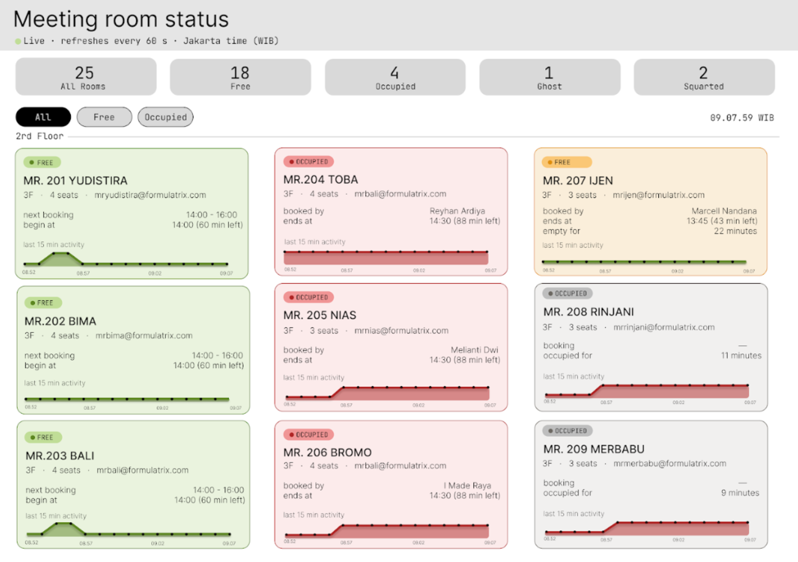

# Meeting Room System

A system that shows which meeting rooms are really in use. It compares **Google Calendar bookings** with **camera-based person detection**, and a dashboard shows the result live.

Booked rooms are often empty, and rooms that nobody booked are often in use. This project finds both cases automatically.



## How it works

```
 Google Calendar ──► CalendarSyncWorker ──┐
                                          ▼
                            SQLite database ──► REST API ──► React dashboard
                                                         ▲
 Room cameras ──► CameraWorker (every 60 s) ──► AI person detection
```

1. **CalendarSyncWorker** reads each room's Google Calendar and stores the current booking.
2. **CameraWorker** takes a snapshot from each room's camera and runs an AI model (SSD MobileNet v1, ONNX) that detects whether a person is in the room.
3. The **API** compares the booking with the detection and gives each room a status.
4. The **dashboard** (React) shows all rooms and refreshes every 60 seconds.

## Room statuses

| Status | Calendar | Camera | Meaning |
|--------|----------|--------|---------|
| **Ghost (booked, empty)** | Booked | Nobody | The booking is not being used |
| **Ghost (in use, not booked)** | No booking | Someone | The room is used without a booking |
| **Occupied** | Booked | Someone | The booking is being used as planned |
| **Free** | No booking | Nobody | The room is available |

A ghost is confirmed only after several camera snapshots in a row agree (10 by default), so one bad frame does not trigger it.

## Tech stack

| Part | Technology |
|------|------------|
| Backend | C#, .NET 8, ASP.NET Core Web API |
| Database | SQLite with Entity Framework Core (migrations) |
| Calendar | Google Calendar API (OAuth) |
| Person detection | ONNX Runtime with SSD MobileNet v1, OpenCvSharp |
| Cameras | UniFi Protect snapshot API, with mock and webcam options for testing |
| Frontend | React 19, Vite, Recharts |

## Project structure

```
MeetingRoomSystem/
├── Program.cs                  App setup, services and database seeding
├── MeetingRoomSystem.csproj
├── appsettings.json            Camera, detection and snapshot settings
├── Controllers/
│   └── RoomsController.cs      REST API (/api/rooms)
├── Data/                       DbContext (4 tables) and booking repository
├── Migrations/                 Database migrations
├── Models/                     ONNX model file (not in git)
├── src/
│   ├── Interfaces/             ICalendarService, ICameraService, IDetectionService
│   ├── Models/                 Booking, MeetingRoom, RoomSnapshot, DetectionResult, ...
│   ├── Services/               Calendar, cameras, detection, ghost detector, snapshots
│   └── Workers/                CalendarSyncWorker, CameraWorker (background jobs)
├── webapp/                     React dashboard (has its own README)
└── Desktop/Dashboard.png       Screenshot
```

## Frontend (dashboard)

A React 19 app built with Vite, in `webapp/`. It calls `GET /api/rooms` every 60 seconds and shows the result as room cards.

- **Top bar:** title, live indicator, and summary counts (all, free, occupied rooms)
- **Filter bar:** All, Free and Occupied buttons, plus a live clock in Jakarta time (WIB)
- **Room card:** status badge, floor, seats, room email, booking times (next, current, or minutes left), and a link to the room's Google Calendar
- **Activity chart:** the last 15 minutes of camera detections for the room, or "camera not connected" for rooms without a camera
- **Colors:** green for free, orange for ghost, red for occupied

Components live in `webapp/src/components/` (`TopBar`, `FilterBar`, `FloorSection`, `RoomCard`). See `webapp/README.md` for the details.

## Database

SQLite file `meetingrooms.db`, created in the working folder on first run. Entity Framework Core migrations in `Migrations/` build the schema, and the app applies them at startup. The file holds real room and booking data, so it is git-ignored.

### Tables

| Table | Filled by | Purpose |
|-------|-----------|---------|
| `MeetingRooms` | Seed data in `Program.cs`, updated by both workers | One row per room: name, floor, capacity, room email, calendar ID, camera ID, current occupancy and current booking |
| `CalendarBookings` | CalendarSyncWorker | Bookings read from Google Calendar (title, organizer, start, end, status) |
| `CameraDetections` | CameraWorker | One row per camera snapshot: person detected or not, confidence, whether the camera was reachable, capture time |
| `DetectionResults` | Ghost detection | The evaluated status per room (ghost, occupied, free), how many minutes it has lasted, and whether an alert was sent |

### Relationships

```
MeetingRooms ──(CurrentBookingEventId)──► CalendarBookings.EventId     (optional, set to null if the booking is deleted)
CalendarBookings.RoomId ········ matches ········ MeetingRooms.CalendarRoomId
CameraDetections.RoomId ········ matches ········ MeetingRooms.CameraRoomId
DetectionResults.RoomId ········ one row per evaluation of a room
```

The dotted links are matched by value in code, not by database foreign keys.

### Key columns

| Table | Important columns |
|-------|-------------------|
| `MeetingRooms` | `Name`, `Location` (floor), `Capacity`, `ResourceEmail`, `CalendarRoomId`, `CameraRoomId`, `IsOccupied`, `LastCheckedAt`, `CurrentBookingEventId` |
| `CalendarBookings` | `EventId` (primary key, Google's event ID), `RoomId`, `Title`, `OrganizerEmail`, `StartTime`, `EndTime`, `Status` (`confirmed` or `cancelled`), `LastSyncedAt` |
| `CameraDetections` | `RoomId`, `PersonDetected`, `DetectionConfidence`, `CameraAvailable`, `CapturedAt` |
| `DetectionResults` | `RoomId`, `Status`, `EvaluatedAt`, `EventId`, `OrganizerEmail`, `AnomalyMinutes`, `AlertSent`, `AlertSentAt` |

### Indexes

- `MeetingRooms.CameraRoomId` is unique (when set), so one camera cannot belong to two rooms.
- `CalendarBookings` is indexed on `(RoomId, StartTime, EndTime)` and on `Status`.
- `CameraDetections` is indexed on `(RoomId, CapturedAt)` for the last-15-minutes chart.
- `DetectionResults` is indexed on `(RoomId, EvaluatedAt)` and on `(Status, AlertSent)`.

### Working with migrations

```bash
dotnet ef migrations add <Name>   # create a migration after changing a model
dotnet ef database update         # apply migrations manually (the app also does this at startup)
```

To reset the data, stop the app and delete `meetingrooms.db`. The app recreates it and re-seeds the rooms on the next start.

## Requirements

- .NET 8 SDK
- Node.js and npm (for the dashboard)
- A Google Cloud project with the Calendar API enabled, and an OAuth desktop client
- Access to the room cameras (UniFi Protect or similar), or use the mock camera for testing
- The ONNX model `ssd_mobilenet_v1_12.onnx`, which is too large for git. Download it from the [ONNX Model Zoo](https://github.com/onnx/models) and put it in `Models/`.

## Setup

### 1. Google Calendar access

1. In Google Cloud Console, enable the **Google Calendar API** and create an **OAuth client ID** of type *Desktop app*.
2. Download the JSON file and save it in the project root as `credentials.json`.
3. On the first run, a browser window asks you to sign in. The token is then saved locally in `token.json`.

Never commit `credentials.json` or `token.json`. Both are in `.gitignore`.

### 2. Configuration

Fill in your own values in these places:

| Where | What to fill in |
|-------|-----------------|
| `appsettings.json` | `NvrBaseUrl`, `ApiToken` and the camera IDs |
| `src/Workers/Cameraworker.cs` | The list of camera snapshot URLs, one per room |
| `src/Workers/CalendarSyncWorker.cs` | The list of Google Calendar IDs, one per room |
| `Program.cs` | The seeded rooms: name, floor, capacity, room email, camera and calendar IDs |

Keep real URLs, tokens and calendar IDs out of any public repository.

### 3. Choose a camera source

`Program.cs` uses `MockCameraService`, which reads test images, so you can try the system without cameras. To use real cameras, switch the registration to `UnifiCameraService` once the NVR address and API token are in `appsettings.json`.

## Run the backend

```bash
dotnet restore
dotnet run
```

On start, the app applies database migrations and seeds the rooms. The API is then available at the URL printed in the console, under `/api/rooms`.

## Run the dashboard

```bash
cd webapp
npm install
npm run dev
```

The dev server forwards `/api` requests to `http://localhost:5000`. See `webapp/README.md` for more.

## API

| Method | Endpoint | Description |
|--------|----------|-------------|
| GET | `/api/rooms` | All rooms grouped by floor, with status, current and next booking, and recent activity, plus a summary |
| GET | `/api/rooms/{id}` | Details for one room |
| GET | `/api/rooms/debug` | Diagnostic view for troubleshooting |


## Limitations

- The room list and the camera and calendar IDs are set in code, so adding a room means editing code and restarting.
- Workers check a fixed list of rooms every cycle (cameras every 60 s, calendars every 10 min).
